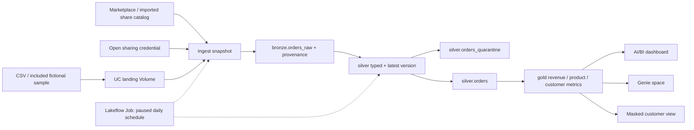

# Retail Orders Analytics — Databricks Free Edition

A compact learning project: Unity Catalog, source ingestion, bronze → silver →
gold, quality quarantine, Lakeflow orchestration, governed reporting, and Genie.
The main demo now reads **actual Delta Sharing** from Databricks Marketplace's
fictional retail dataset. Both the sample-source and shared-source jobs passed in
your workspace. The shared-source run produced 7,643 accepted latest lines, 355
quarantined lines, and $10,062,538.04 of modeled completed-sales revenue.

Open the [published dashboard](https://dbc-52ad64ac-9d22.cloud.databricks.com/dashboardsv3/01f1dd3854d21e60b53a9f1db75729e5/published?o=7474646606974334),
[Genie space](https://dbc-52ad64ac-9d22.cloud.databricks.com/genie/rooms/01f1dd387b6d163d91f8a1ad05a52a56?o=7474646606974334),
or [successful job run](https://dbc-52ad64ac-9d22.cloud.databricks.com/jobs/941905938262771/runs/89815997261296?o=7474646606974334).
See [verified status and remaining manual evidence](docs/implementation-status.md).



## Run it

The bundle targets your workspace at
`https://dbc-52ad64ac-9d22.cloud.databricks.com`. It deploys source into your supplied
`/Workspace/Users/anmolkoul11@gmail.com/Databricks_Demo` folder, which was verified
empty before deployment. Bundle state lives separately under the user's `.bundle` folder.
See [the runbook](docs/runbook.md) for a manual Git-folder route and troubleshooting.

With the current [official Databricks CLI](https://docs.databricks.com/aws/en/dev-tools/cli/install):

```powershell
databricks auth login --host https://dbc-52ad64ac-9d22.cloud.databricks.com --profile RETAIL_DEMO
.\tools\bootstrap.ps1 -Profile RETAIL_DEMO
databricks bundle validate -t dev -p RETAIL_DEMO --strict
databricks bundle deploy -t dev -p RETAIL_DEMO
databricks bundle run retail_demo -t dev -p RETAIL_DEMO
```

An official CLI binary downloaded for this project can instead be invoked as
`.\.tools\databricks.exe`. The installer script `tools/install_cli.ps1` downloads
the latest official Windows AMD64 release and verifies its published SHA256.
Complete OAuth in the browser; never paste credentials into this repo or chat.
Bootstrap uses the existing SQL warehouse to create the catalog and schemas before
the pipeline resource is deployed. SQL uses Free Edition's default storage; the
plain catalog REST create endpoint may require a storage root instead.

The job runs **setup → ingest → pipeline → governance → validate**, sequentially.
Your configured `dev` target uses `source_mode=marketplace` and the installed
`retail_provider` catalog. See [provider mapping and attribution](docs/provider-adapter.md).
On another workspace, first review/install that listing as `retail_provider`, or
deploy with `--var source_mode=sample` to use the included CSV instead.
Default catalog: `retail_demo`. The daily 08:00 America/New_York schedule is
**paused**, with no automatic retries and a one-hour job timeout. Unpause only after
the first run succeeds; keep it paused when you finish the demo. Development mode
also pauses schedules. Read [deployment status](docs/implementation-status.md) for
what was actually verified, rather than assuming these commands have been run.

If the pipeline is unavailable, use the separate notebook catalog:

```powershell
databricks bundle run retail_notebooks -t dev -p RETAIL_DEMO
```

Do not target pipeline-owned objects with `CREATE OR REPLACE TABLE`. The fallback
uses `retail_demo_notebooks` to avoid that conflict. Shared SQL in `retail/model.py`
defines the same transformations in both paths.

## What you get

| Layer | Objects and behavior |
| --- | --- |
| raw_share | Managed landing and separate credential Volumes |
| bronze | `orders_raw`: complete snapshot, source payload, `ingest_ts`, provenance |
| silver | Typed/ranked rows, latest-line quarantine, deduplicated `orders` |
| gold | Daily revenue, product metrics, category revenue, regional revenue, restricted customer metrics |
| governance | Dynamic `customer_metrics_masked` view; explicit grants on safe reporting objects |
| orchestration | Serverless pipeline and sequential Job, plus notebook fallback Job |
| reporting | [Dashboard queries](reporting/dashboard_queries.sql), [Genie benchmarks](reporting/genie_benchmarks.sql), and [setup guide](docs/reporting.md) |

The optional 1,211-row local sample yields 1,199 accepted latest lines and 9 quarantined
latest lines. Three extra historical/replayed rows are removed by deduplication.
Rows deliberately include a corrected quantity and a newer malformed correction;
the latter quarantines that key instead of restoring its stale valid version.
All customer addresses use the reserved `example.invalid` domain.

Revenue is completed-sales revenue in USD after discounts; returned and cancelled
lines are excluded. It does not model taxes, shipping, or refund accounting. See
[the source contract](docs/source-contract.md) for grain, defaults, rounding,
snapshot behavior, and how to map a real source.

## Corrections to the original plan

- A shared listing becomes a separate read-only catalog, not `retail_demo.raw_share`.
  Marketplace's standard consumer prerequisites mention Premium; availability in a
  specific Free workspace must be tested. Keep a truthful source-attempt log.
- Unity Catalog cannot grant privileges to the workspace-local `users` or `admins`
  groups. Use a named account group, `account users` if deliberately broad, or a user
  email. `is_account_group_member` checks account membership. Default PII access is
  disabled; configure a verified account group only if available.
- Gold is not uniformly public: do not grant SELECT on its entire schema. That would
  expose the customer backing table and bypass the view. Grant the four aggregates
  and the masked view individually. A new demo catalog avoids inherited reader grants;
  existing catalog privileges still require inspection.
- The direct Spark sharing connector is not a guaranteed serverless fallback. The
  optional bounded pandas path avoids JAR installation but still requires egress.

References: [Marketplace](https://docs.databricks.com/aws/en/marketplace/get-started-consumer),
[UC principals](https://docs.databricks.com/aws/en/sql/language-manual/sql-ref-principal),
[account membership](https://docs.databricks.com/aws/en/sql/language-manual/functions/is_account_group_member),
[sharing connector](https://github.com/delta-io/delta-sharing).

## Free Edition constraints

Official limits checked 2026-11-10: serverless only; one 2X-Small SQL warehouse;
five concurrent job tasks per account; one active pipeline per pipeline type;
restricted outbound domains. This project uses one triggered pipeline and serial
tasks. Fair-use limits can stop compute for the day, or in extreme cases the month.
There is no published row-count entitlement; the 50,000-row guard is this demo's
conservative choice, not a Databricks limit. Sample size is intentionally much smaller.

Free Edition is non-commercial, lacks an SLA, may delete long-inactive accounts,
and cannot act as a Marketplace provider. These facts do not establish that all
outbound sharing is disabled: test provider privileges separately. Export/push code
to your own Git remote as backup. [Official Free Edition limitations](https://docs.databricks.com/aws/en/getting-started/free-edition-limitations).

## Local validation

```powershell
uv run --group dev python -m unittest discover -s tests -v
```

Local tests execute the shared SQL with DuckDB and check corrections, malformed rows,
deduplication/replay, all gold revenue totals, rounding, masking logic, and job paths.
They do not validate Spark semantics, Databricks permissions, remote networking,
pipeline decorators, or UI availability. `04_validate.py` performs real workspace
acceptance checks after deployment; a second identity is needed to prove reader isolation.

The sample is reproducible with `python tools/generate_sample.py`. No real customer
data, profile credentials, API tokens, or external dataset licenses are included.
