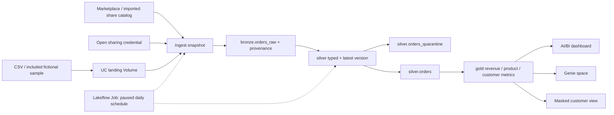

# Retail Orders Analytics

A retail analytics project built on Databricks Free Edition. It takes purchase
orders from a Delta Sharing catalog, cleans them through a bronze–silver–gold
pipeline, and makes the results available in an AI/BI dashboard and Genie space.

I built this to work through the full Databricks workflow: connecting to a shared
source, handling messy order data, setting up access controls, and turning cleaned
tables into useful reports. The source records are fictional, but the Marketplace
installation and Delta Sharing connection are real.

## Architecture



The main job runs **setup → ingest → pipeline → governance → validate**. The source
catalog stays read-only; all transformations happen in `retail_demo`.

| Layer | What it contains |
| --- | --- |
| `raw_share` | Landing and credential Volumes, plus the view that adapts shared orders |
| `bronze` | A source snapshot with the original payload, ingestion time, and source details |
| `silver` | Typed and deduplicated order lines, with rejected records kept in quarantine |
| `gold` | Daily revenue, product, category, region, and customer metrics |
| Reporting | AI/BI dashboard, Genie space, and a masked customer view |

The stack is **Databricks, Delta Lake, Unity Catalog, PySpark, SQL, Delta Sharing,
Lakeflow Declarative Pipelines, Lakeflow Jobs, AI/BI dashboards, and Genie**.
Deployment uses Databricks bundles. Local SQL tests run with DuckDB.

## What the data needed

The Marketplace source stores each order's products in a JSON array. The adapter
turns those arrays into order lines and handles a few details that matter for the
numbers:

- Some orders declare a different line count from the array they contain. Those
  lines go to quarantine.
- A promotion can cover only part of a line's quantity. The adapter separates the
  discounted and regular units so the discount is applied correctly.
- Product categories come from a name-based lookup. Missing or conflicting matches
  become `Unknown`; customer regions use the latest available customer record.
- The source has no order-status or email field. Purchase orders are treated as
  completed, and email stays NULL.

The [provider notes](docs/provider-adapter.md) explain these choices and include
source attribution. The [source contract](docs/source-contract.md) covers the
expected fields, quality rules, and metric definitions.

## Results from the shared-source run

| Metric | Result |
| --- | ---: |
| Bronze records | 8,138 |
| Accepted latest order lines | 7,643 |
| Quarantined latest lines | 355 |
| Older or replayed records removed | 140 |
| Accepted completed orders | 3,808 |
| Modeled sales revenue (USD) | $10,062,538.04 |

The accepted data covers August 1 through November 14, 2019. Revenue agrees across
all five gold models. Both the sample and Marketplace jobs completed successfully,
and Genie returned the same total as the SQL query.

These are results from fictional purchase orders, not business revenue generated
by the project. Revenue is calculated after discounts and rounding per line;
shipping, taxes, and refund accounting are outside the model.

Workspace access is required for these links:

- [Sales Pulse dashboard](https://dbc-52ad64ac-9d22.cloud.databricks.com/dashboardsv3/01f1dd3854d21e60b53a9f1db75729e5/published?o=7474646606974334)
- [Retail Orders Analyst in Genie](https://dbc-52ad64ac-9d22.cloud.databricks.com/genie/rooms/01f1dd387b6d163d91f8a1ad05a52a56?o=7474646606974334)
- [Successful Marketplace job run](https://dbc-52ad64ac-9d22.cloud.databricks.com/jobs/941905938262771/runs/89815997261296?o=7474646606974334)

The [run results](docs/implementation-status.md) separate completed checks from
items that still need a manual review.

## Running the project

The checked-in `dev` target points to the original demo workspace and uses
`source_mode=marketplace`. For a different workspace, update `workspace.host` in
`databricks.yml` and review its deployment paths before starting.

Use the [official Databricks CLI](https://docs.databricks.com/aws/en/dev-tools/cli/install)
and an existing serverless SQL warehouse. On Windows, `tools/install_cli.ps1` can
download the CLI into `.tools` and verify the release checksum. If using that copy,
replace `databricks` below with `.\.tools\databricks.exe`.

```powershell
databricks auth login --host https://YOUR_WORKSPACE.cloud.databricks.com --profile RETAIL_DEMO
.\tools\bootstrap.ps1 -Profile RETAIL_DEMO
databricks bundle validate -t dev -p RETAIL_DEMO --strict
databricks bundle deploy -t dev -p RETAIL_DEMO
databricks bundle run retail_demo -t dev -p RETAIL_DEMO
```

Bootstrap creates the catalog and schemas before deployment, since the pipeline
needs its catalog to exist when it is created. The shared-source path expects the
**Simulated Retail Customer Data** listing to be installed as `retail_provider`.
Review and accept the listing's terms when installing it in another workspace.

To try the project without a shared catalog, deploy the included CSV instead:

```powershell
databricks bundle deploy -t dev -p RETAIL_DEMO --var source_mode=sample
databricks bundle run retail_demo -t dev -p RETAIL_DEMO
```

That fixture has 1,211 rows, including duplicates, a correction, and deliberately
bad values. It produces 1,199 accepted lines and 9 quarantined lines after
deduplication. Its email addresses use `example.invalid`.

The daily schedule is set to **08:00 America/New_York** and is **paused**. The main
job allows one run at a time, has no automatic retries, and stops after an hour.
Keep the schedule paused between demos to save compute quota.

There is also a notebook-only path:

```powershell
databricks bundle run retail_notebooks -t dev -p RETAIL_DEMO
```

It uses the same SQL in `retail/model.py`, but writes to `retail_demo_notebooks` so
it does not conflict with the pipeline's materialized views. See the
[runbook](docs/runbook.md) for manual notebook setup and troubleshooting.

## Access and reporting

Readers get access to four gold aggregates and `customer_metrics_masked`.
The underlying customer table, bronze, silver, and credential Volume stay outside
those grants. Email is masked by default; a named account group can be configured
for PII access. Granting SELECT on the whole gold schema would bypass that design.

The dashboard uses viewer credentials. Genie is limited to the four aggregate
tables and includes metric definitions, sample SQL, and benchmark questions. The
[reporting guide](docs/reporting.md) explains the layout and how to rebuild it.

The outbound sharing exercise also worked: `gold.daily_revenue` was added to
`retail_demo_gold_share` as a materialized view. No recipients were granted access,
so an external read has not been tested.

## Local checks

```powershell
uv run --group dev python -m unittest discover -s tests -v
```

The eight tests cover corrections, quarantine, deduplication, replay behavior,
rounding, revenue reconciliation, masking logic, and job configuration. They run
the shared SQL in DuckDB; workspace checks in `notebooks/04_validate.py` cover the
Databricks run. Permissions still need a separate reader identity to test fully.

Regenerate the fixture with `python tools/generate_sample.py`. Code and sample data
are tracked in Git; credentials, local tools, and temporary files are ignored.

## Free Edition notes

The project uses one triggered serverless pipeline and sequential job tasks. The
50,000-row ingestion cap is a project choice to keep the demo small, not a
Databricks row allowance.

The [Free Edition limits](https://docs.databricks.com/aws/en/getting-started/free-edition-limitations)
checked on November 10, 2026 include fair-use compute quotas, restricted outbound
access, one SQL warehouse, and one active pipeline per pipeline type. Free Edition
is for non-commercial learning, has no SLA, and may remove long-inactive accounts.
Keep a copy of the project in GitHub rather than relying on workspace storage.
